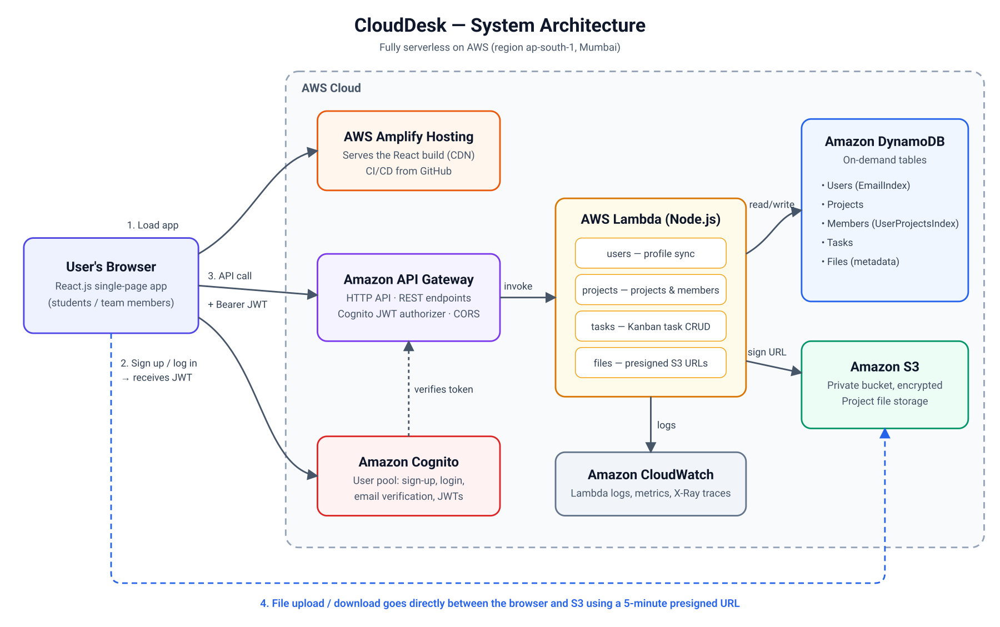

# CloudDesk — Bringing Teams, Tasks, and Ideas Together

CloudDesk is a cloud-based team collaboration platform that helps students manage academic projects. Teams get one shared workspace to **create projects, add teammates, assign tasks on a Kanban board, track progress, and share files**.

The whole backend is **serverless on AWS**: there are no servers to manage, it scales automatically, and you pay only for what you use.

> Cloud Computing and Services project (UCT512) — submitted to Dr. Samya Muhuri
> Team: Daksh Rishi (1024180004) · Dinkle Arora (1024180058) · Purav Garg (1024180006)

---

## Features

| Area | What you can do |
|---|---|
| **Accounts** | Sign up with email, verify with a code, sign in securely (Amazon Cognito) |
| **Projects** | Create, edit and delete projects; see every project you belong to |
| **Team** | Owner adds teammates by email, removes members; members can leave |
| **Tasks** | Kanban board (To Do / In Progress / Done), drag-and-drop, assignee, priority, due date, overdue highlighting, "only my tasks" filter |
| **Progress** | Live completion percentage per project |
| **Files** | Upload (drag-and-drop, progress bar), download and delete project files up to 25 MB, stored privately in Amazon S3 |

## Architecture



| AWS service | Role in CloudDesk | Why we chose it |
|---|---|---|
| **AWS Amplify Hosting** | Hosts the React frontend on a CDN, redeploys on every `git push` | Free tier, built-in CI/CD, HTTPS |
| **Amazon Cognito** | User sign-up, login, email verification, issues JWT tokens | Managed authentication — we never store passwords |
| **Amazon API Gateway (HTTP API)** | Public REST API; verifies the Cognito JWT on every request; CORS | Auth is enforced *before* our code runs |
| **AWS Lambda (Node.js 22)** | 4 functions: `users`, `projects`, `tasks`, `files` | Runs only when called, scales automatically, no servers |
| **Amazon DynamoDB** | Stores users, projects, members, tasks and file metadata | Serverless NoSQL, single-digit-ms key lookups, on-demand billing |
| **Amazon S3** | Stores uploaded files (private, encrypted) | Cheap, durable object storage |
| **Amazon CloudWatch / X-Ray** | Lambda logs, metrics and request tracing | Monitoring and debugging |
| **AWS SAM / CloudFormation** | Whole backend defined as code in `backend/template.yaml` | One command creates or deletes everything (Infrastructure as Code) |

### How a file upload works (presigned URLs)
1. The browser asks the `files` Lambda for an upload URL.
2. Lambda checks that the user is a project member and returns a **presigned S3 URL that is valid for 5 minutes**.
3. The browser uploads the file **directly to S3** — the bytes never pass through Lambda or API Gateway, which is faster, cheaper and avoids API size limits.
4. The browser confirms the upload; Lambda verifies the object exists in S3 and saves its metadata in DynamoDB.

### Security
- Every API route needs a valid Cognito token (API Gateway JWT authorizer).
- Every Lambda checks that the caller is a **member** of the project (owner-only actions are checked too). Non-members get `404`, so they can't even tell a project exists.
- The S3 bucket blocks all public access and is encrypted; files are reachable only through short-lived presigned URLs.
- Each Lambda's IAM role can access only the tables and bucket it needs (least privilege).

## Data model (DynamoDB)

| Table | Partition key | Sort key | Secondary index | Stores |
|---|---|---|---|---|
| `clouddesk-dev-users` | `userId` | — | `EmailIndex` (email) | name, email |
| `clouddesk-dev-projects` | `projectId` | — | — | name, description, owner |
| `clouddesk-dev-members` | `projectId` | `userId` | `UserProjectsIndex` (userId, projectId) | role (`owner`/`member`), name, email |
| `clouddesk-dev-tasks` | `projectId` | `taskId` | — | title, description, status, priority, assignee, due date |
| `clouddesk-dev-files` | `projectId` | `fileId` | — | S3 key, name, size, type, uploader |

The `UserProjectsIndex` answers "which projects am I in?", and `EmailIndex` answers "which user has this email?" — both without scanning a table.

## API reference

Base URL: the `ApiUrl` output of the deployment. Every request needs `Authorization: Bearer <Cognito ID token>`.

| Method | Path | Description |
|---|---|---|
| POST | `/me` | Save/refresh the signed-in user's profile |
| GET | `/projects` | List my projects |
| POST | `/projects` | Create a project `{ name, description }` |
| GET | `/projects/{projectId}` | Project details + members |
| PATCH | `/projects/{projectId}` | Edit name/description (owner) |
| DELETE | `/projects/{projectId}` | Delete project, its tasks, files and members (owner) |
| POST | `/projects/{projectId}/members` | Add member `{ email }` (owner) |
| DELETE | `/projects/{projectId}/members/{userId}` | Remove member (owner) or leave (self) |
| GET | `/projects/{projectId}/tasks` | List tasks |
| POST | `/projects/{projectId}/tasks` | Create task `{ title, description?, status?, priority?, assigneeId?, dueDate? }` |
| PATCH | `/projects/{projectId}/tasks/{taskId}` | Update any task fields (`null` clears assignee/due date) |
| DELETE | `/projects/{projectId}/tasks/{taskId}` | Delete task |
| GET | `/projects/{projectId}/files` | List files |
| POST | `/projects/{projectId}/files/upload-url` | Get presigned upload URL `{ fileName, contentType, size }` |
| POST | `/projects/{projectId}/files` | Confirm upload `{ fileId, key }` |
| GET | `/projects/{projectId}/files/{fileId}/download-url` | Get presigned download URL |
| DELETE | `/projects/{projectId}/files/{fileId}` | Delete file (uploader or owner) |

## Project structure

```
clouddesk/
├── backend/
│   ├── template.yaml            # AWS SAM: Cognito, API Gateway, Lambda, DynamoDB, S3
│   └── src/
│       ├── package.json
│       ├── lib/                 # shared helpers: http, db, s3, access checks
│       └── handlers/            # users.js, projects.js, tasks.js, files.js
├── frontend/
│   ├── index.html
│   ├── vite.config.js
│   ├── .env.example
│   └── src/
│       ├── main.jsx, App.jsx, api.js, config.js, utils.js, styles.css
│       ├── pages/               # ProjectsPage, ProjectPage
│       └── components/          # TaskBoard, FilesPanel, MembersPanel, Navbar, Modal, Avatar
├── docs/architecture.svg / .png
└── amplify.yml                  # build settings for AWS Amplify Hosting
```

---

## Deployment guide

### Prerequisites (install once)
- An AWS account. **First create a budget alert** (Billing → Budgets → "Zero spend budget") so you're emailed if anything starts costing money.
- [Node.js 20+](https://nodejs.org)
- [AWS CLI v2](https://docs.aws.amazon.com/cli/latest/userguide/getting-started-install.html) — then run `aws configure` with an IAM user's access key, region `ap-south-1`
- [AWS SAM CLI](https://docs.aws.amazon.com/serverless-application-model/latest/developerguide/install-sam-cli.html)
- Git and a GitHub repository for this project

### 1. Deploy the backend
```bash
cd backend
sam build
sam deploy --guided
```
Answer the prompts like this:
- Stack Name: `clouddesk-dev`
- AWS Region: `ap-south-1`
- Parameter Stage: `dev`
- Confirm changes before deploy: `N`
- Allow SAM CLI IAM role creation: `Y`
- Disable rollback: `N`
- "...Function has no authentication. Is this okay?" — this prompt should not appear (all routes use the Cognito authorizer); if it does, answer `y`
- Save arguments to configuration file: `Y`

After a few minutes SAM prints the **Outputs**: `ApiUrl`, `UserPoolId`, `UserPoolClientId`, `Region`. Later deploys are just `sam build && sam deploy`.

### 2. Run the frontend locally
```bash
cd frontend
cp .env.example .env      # on Windows: copy .env.example .env
# put the Outputs from step 1 into .env
npm install
npm run dev
```
Open http://localhost:5173, create an account, and check your email for the verification code.

### 3. Host the frontend on AWS Amplify (CI/CD)
1. Push the whole project to GitHub.
2. AWS Console → **AWS Amplify** → *Create new app* → *GitHub* → choose the repo and branch.
3. Tick **"My app is a monorepo"** and enter `frontend` as the root directory. Amplify picks up `amplify.yml` automatically.
4. Under **Advanced settings → Environment variables**, add `VITE_API_URL`, `VITE_USER_POOL_ID`, `VITE_USER_POOL_CLIENT_ID`, `VITE_AWS_REGION` with the values from step 1.
5. Deploy. After it finishes, go to **Hosting → Rewrites and redirects** and add this rule so page refreshes work on routes like `/projects/123`:
   - Source: `</^[^.]+$|\.(?!(css|gif|ico|jpg|js|png|txt|svg|woff|woff2|ttf|map|json|webp)$)([^.]+$)/>`
   - Target: `/index.html`
   - Type: `200 (Rewrite)`

Now every `git push` rebuilds and redeploys the site automatically.

### 4. Try it with your team
1. Each teammate signs up once.
2. One person creates a project and adds the others by email in the **Members** tab.
3. Create tasks, assign them, drag them across the board, upload files.

### Monitoring
AWS Console → **CloudWatch → Log groups → `/aws/lambda/clouddesk-dev-*`** shows every request and error. **X-Ray → Traces** shows the time spent in API Gateway, Lambda, DynamoDB and S3 for each request.

### Cost
With student-level usage everything stays within the AWS Free Tier: Lambda (1M requests/month), DynamoDB on-demand (pay per request; tiny at this scale), API Gateway HTTP API, S3 (a few MB), Cognito (free tier covers 10,000 monthly active users) and Amplify Hosting. Keep the budget alert on anyway.

### Delete everything after evaluation
```bash
aws s3 rm s3://<FilesBucketName> --recursive   # bucket must be empty before deletion
cd backend && sam delete
```
Then delete the app in the Amplify console.

## Troubleshooting
| Problem | Fix |
|---|---|
| "CloudDesk is not configured" page | `.env` (or Amplify environment variables) is missing a value; restart `npm run dev` after editing `.env` |
| "Could not reach the CloudDesk API" | Wrong `VITE_API_URL` — it must include the stage, e.g. `.../dev`, with no trailing slash |
| Verification email doesn't arrive | Check spam. Cognito's built-in email sender is limited to ~50 emails/day — enough for a demo |
| "No CloudDesk user has this email" | That teammate must sign up and log in once before being added |
| File upload fails with 403 | The presigned URL expired (5 minutes) — try again; also check the bucket CORS rule in `template.yaml` |
| 404 on page refresh after hosting | Add the Amplify rewrite rule from step 3.5 |

## Future scope
Real-time updates with API Gateway WebSockets, email notifications with Amazon SES, task comments, activity history, and calendar view of due dates.
